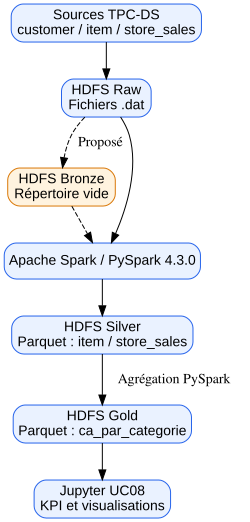
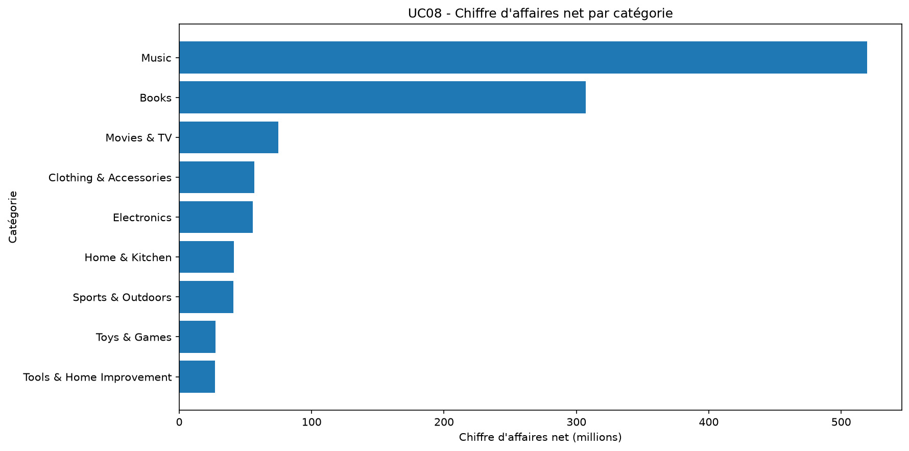
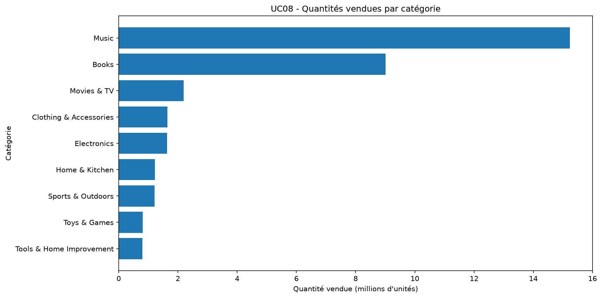
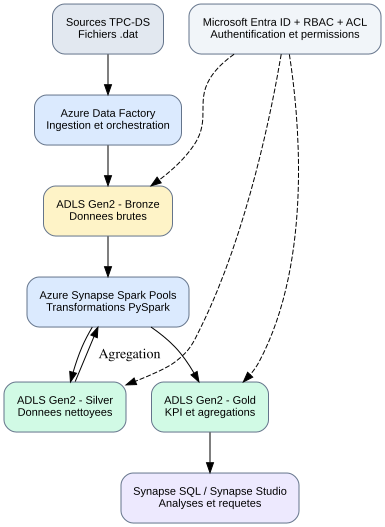

# Retail Intelligence Platform
### Transformer les données commerciales en intelligence décisionnelle

Retail Intelligence Platform est une plateforme de Data Engineering
et de Business Intelligence conçue pour transformer des données
transactionnelles brutes en indicateurs fiables et exploitables.

## Pourquoi ce projet ?

Dans le retail, les transactions génèrent d'importants volumes
de données. Leur exploitation nécessite une infrastructure capable
de les centraliser, les contrôler, les transformer et les analyser.

L'objectif est de répondre à des questions métier concrètes :
- Quelles catégories génèrent le plus de chiffre d'affaires ?
- Quels produits contribuent aux performances commerciales ?
- Comment fiabiliser les données utilisées pour les analyses ?
- Comment industrialiser la production des indicateurs ?

## Architecture de la plateforme

La plateforme repose sur Hadoop HDFS et Apache Spark.

Les fichiers sources sont conservés dans la zone Raw.
Les transformations PySpark produisent les données Silver
et les agrégations Gold au format Parquet.

La zone Bronze est prévue dans l'architecture mais
n'est pas encore alimentée.

## Technologies

| Domaine | Technologies |
|---|---|
| Stockage | Hadoop HDFS |
| Ingestion | Apache NiFi |
| Traitement | Apache Spark, PySpark |
| Format analytique | Parquet Snappy |
| Analyse | Python, Jupyter Notebook |
| Versionnement | Git, GitHub |
| Architecture cloud étudiée | ADLS Gen2, Azure Data Factory, Azure Synapse |

## Résultats analytiques

| Indicateur | Résultat |
|---|---:|
| Lignes de ventes | 667 579 |
| Chiffre d'affaires net calculé | 1 150 529 586,37 |
| Quantités vendues | 33 755 474 |
| Catégories analysées | 9 |

Les catégories Music et Books concentrent environ
71,87 % du chiffre d'affaires calculé.

Ces résultats proviennent d'un jeu de données de
benchmark et ne représentent pas une entreprise réelle.

## Visualisations

### Chiffre d'affaires par catégorie

### Quantités vendues par catégorie

## Qualité et traçabilité

La plateforme intègre des contrôles sur les valeurs
manquantes, les doublons, les schémas et la cohérence
des agrégations.

Les permissions HDFS et la séparation des zones
font également partie de la démarche de gouvernance.

## Transposition vers Azure

Une architecture équivalente est étudiée avec
Azure Data Lake Storage Gen2, Azure Data Factory
et Azure Synapse Analytics.

Cette transposition est conceptuelle : aucun
service Azure n'a été déployé dans le cadre de l'UC07.

## Perspectives

Les prochaines évolutions envisagées comprennent
l'automatisation des pipelines, l'amélioration de
la gouvernance, l'intégration d'Apache Iceberg,
l'interrogation SQL avec Trino et une éventuelle
migration vers une infrastructure cloud.

---

**Retail Intelligence Platform — De la donnée brute à la décision.**
