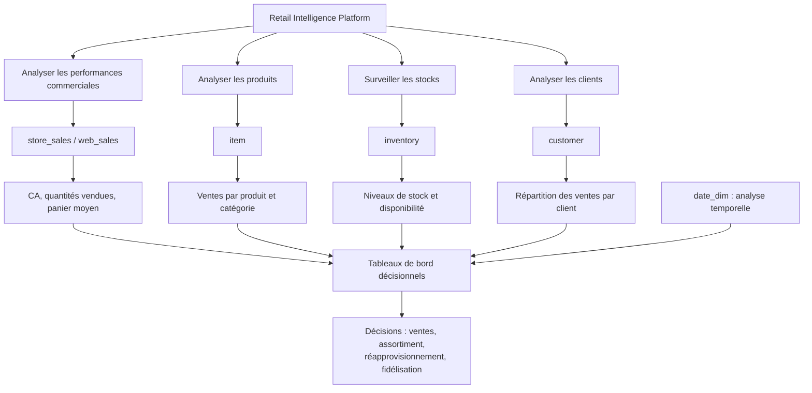

# UC-01 — Schéma des besoins métier

## Objectif

Identifier les besoins décisionnels de la plateforme Retail
Intelligence Platform et les relier aux sources de données
disponibles.

## Schéma fonctionnel

## Interprétation

Le schéma présente quatre axes d'analyse :
- Performance commerciale
- Performance des produits
- Gestion des stocks
- Analyse des clients

Les sources identifiées alimenteront des indicateurs
permettant aux décideurs de suivre l'activité commerciale.

La dimension temporelle date_dim permettra d'analyser
l'évolution des indicateurs par période.

Les calculs définitifs des KPI dépendront de la validation
des règles métier et des relations entre les tables.

# UC-01 — Schéma des besoins métier

## Objectif

Identifier les besoins décisionnels de la plateforme Retail
Intelligence Platform et les relier aux sources de données
disponibles.

## Schéma fonctionnel

## Interprétation

Le schéma présente quatre axes d'analyse :
- Performance commerciale
- Performance des produits
- Gestion des stocks
- Analyse des clients

Les sources identifiées alimenteront des indicateurs
permettant aux décideurs de suivre l'activité commerciale.

La dimension temporelle date_dim permettra d'analyser
l'évolution des indicateurs par période.

Les calculs définitifs des KPI dépendront de la validation
des règles métier et des relations entre les tables.
