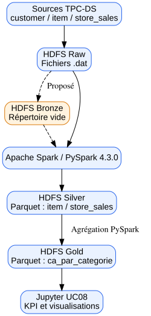
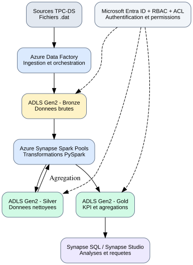

# UC07 — Transposition de la plateforme Retail Intelligence sur Azure

## 1. Choix du parcours

**Parcours B : Local / Open Source**

L'offre d'essai Azure ayant déjà été utilisée, le projet
est réalisé dans un environnement local sous Ubuntu WSL2.

L'objectif est de démontrer le fonctionnement d'une
architecture Data Lake et de proposer sa transposition
vers les services Microsoft Azure, sans consommation cloud.

## 2. Environnement réellement utilisé

| Composant | Technologie | Statut |
|---|---|---|
| Environnement | Ubuntu WSL2 | Utilisé |
| Stockage distribué | Hadoop HDFS | Vérifié |
| Traitement | Apache Spark / PySpark 4.3.0 | Vérifié |
| Format analytique | Parquet Snappy | Vérifié |
| Analyse | Jupyter Notebook | Utilisé |
| Ingestion | Apache NiFi | À confirmer pour UC07 |

## 3. Architecture locale

Les données sources sont stockées dans HDFS.

- Raw : fichiers TPC-DS customer, item et store_sales.
- Bronze : répertoire créé mais actuellement vide.
- Silver : données item et store_sales au format Parquet.
- Gold : agrégation ca_par_categorie au format Parquet.

Les analyses et visualisations sont réalisées dans UC08.

## 4. Architecture Azure proposée

| Fonction | Solution Azure |
|---|---|
| Organisation des ressources | Abonnement et groupe de ressources |
| Stockage | ADLS Gen2 avec HNS activé |
| Ingestion et orchestration | Azure Data Factory |
| Traitement | Azure Synapse Spark Pools |
| Requêtes analytiques | Synapse SQL |
| Développement et supervision | Synapse Studio |
| Identité | Microsoft Entra ID |
| Autorisations | Azure RBAC et ACL |
| Secrets | Azure Key Vault |

Aucun service Azure n'a été déployé pour cette UC.

## 5. Organisation et sécurité

L'organisation proposée des zones Bronze, Silver et Gold,
les règles de nommage, la traçabilité et le fonctionnement
du Hierarchical Namespace sont détaillés dans :

[Organisation ADLS Gen2](architecture/organisation_adls.md)

La matrice de permissions est disponible dans :

[Permissions proposées](securite/matrice_permissions.csv)

La sécurité locale a été examinée avec les commandes
HDFS getfacl. Les droits observés sont différents de
la matrice cible.

## 6. Comparaison Azure / Open Source

[Tableau de correspondance](preuves/uc07/comparaison_azure_opensource.csv)

HDFS assure le stockage distribué, Spark les traitements,
tandis que MinIO, Trino et Iceberg sont étudiés comme
solutions complémentaires possibles.

## 7. Preuves techniques

- verification_environnement.txt : HDFS et PySpark.
- permissions_hdfs.txt : droits d'accès HDFS.
- comparaison_azure_opensource.csv : responsabilités.
- schema_architecture.mmd : schéma source.

Toutes les preuves sont conservées dans UC07/preuves/uc07
ou dans UC07/architecture.

## 8. Limites et justification

Le parcours B permet de réutiliser les traitements
développés dans UC06 et les analyses réalisées dans UC08,
sans coût supplémentaire lié à Azure.

Il ne démontre pas un déploiement effectif dans Azure,
ni le fonctionnement réel des identités, rôles,
permissions et services managés Azure.

La zone Bronze reste à alimenter.
Les services Azure sont présentés comme une architecture
cible et une simulation conceptuelle.

## 9. Schéma de transposition Azure

Ce schéma représente les services qui seraient utilisés
dans le parcours Azure. Aucun de ces services n'a été
déployé dans le cadre de l'UC07.
